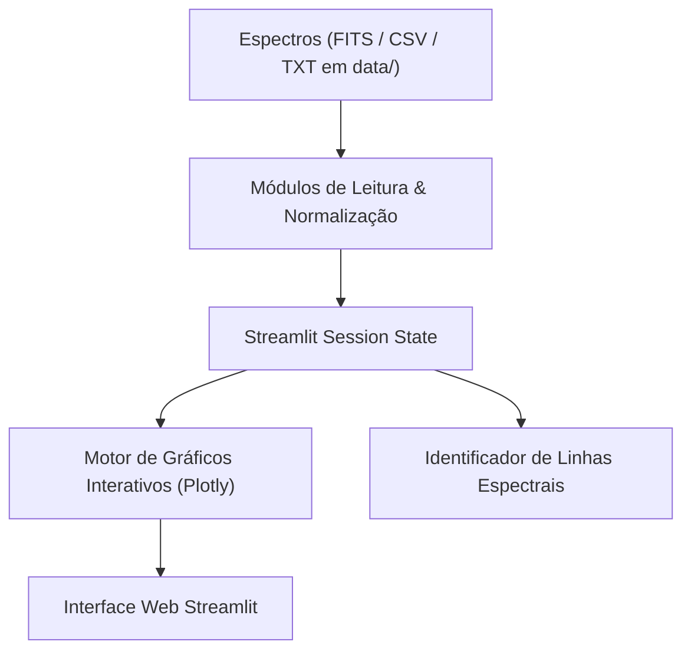

# DESIGN — SpectraViewer Architecture & Design Rules

## 1. Arquitetura da Aplicação

---

## 2. Princípios de Design

1. **Performance no Navegador:**
   - Evitar re-renderização completa de curvas com mais de 50.000 pontos; aplicar downsampling visual para visualização panorâmica e resolução total apenas na área de zoom.
2. **Separação de Funções Científicas:**
   - Lógica de normalização de contínuo e ajuste Gaussiano/Lorentziano deve residir em funções puras testáveis sem dependência do contexto do Streamlit.
